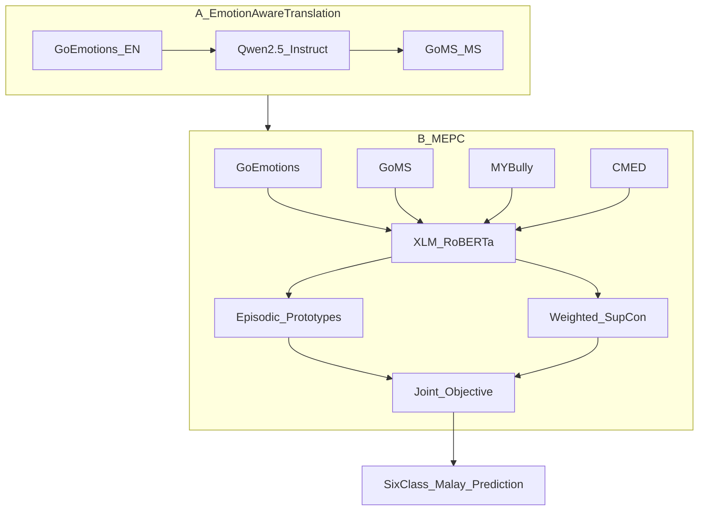

# Large Language Models for Emotion Understanding

**Malay emotion recognition via Emotion-Aware Translation (EAT) and a Multilingual Episodic Prototypical Contrastive Network (MEPC)**

Malaysia Science Scholar’s Programme (MSSP) 2026

**Authors:** Chon Feng Qi · Hong Li Thon · Tee Chun Shan  
**Mentor:** Tan Jing Jie

[Paper (PDF)](papers/Paper.pdf)

---

## Highlights

| Setting | Metric | Score |
| --- | --- | --- |
| EAT vs TOGA semantic fidelity | Similarity to English | **0.7891** |
| Downstream BERT (7-class, EAT-7B) | Balanced Accuracy | **0.7138** |
| MEPC–EAT (GoMS + MYBully, *n* = 1,172) | BalAcc / Macro-F1 / Weighted-F1 | **0.5983 / 0.5829 / 0.6095** |

EAT-7B also surpasses proprietary Google Translate on the 7-class downstream probe (0.7138 vs 0.7050).

### Quick start

```bash
python3 scripts/setup_env.py   # interactive: venv + deps + checks
source .venv/bin/activate
python -m jupyter notebook
```

Core deps: [`requirements.txt`](requirements.txt) · optional EAT extras: [`requirements-translate.txt`](requirements-translate.txt)

## Table of contents

- [Overview](#overview)
- [Pipeline](#pipeline)
- [Results](#results)
- [Repository layout](#repository-layout)
- [Datasets](#datasets)
- [Method](#method)
- [Reproducibility](#reproducibility)
- [Setup](#setup)
- [Running the notebooks](#running-the-notebooks)
- [Outputs](#outputs)
- [Citation](#citation)
- [Data licence note](#data-licence-note)

## Overview

Emotion recognition supports social-media analysis, mental-health monitoring, and human-centred AI, yet low-resource languages such as Bahasa Melayu remain constrained by scarce annotated corpora and severe class imbalance. Literal English-to-Malay translation often preserves surface meaning while losing affective tone, sarcasm, and pragmatic intent.

This project addresses that gap with a two-stage framework:

1. **Emotion-Aware Translation (EAT)** — an open-weight Qwen2.5 instruction model is conditioned on ground-truth emotion labels to translate English GoEmotions into an affect-aligned Malay corpus (**GoMS**), compared against unconditioned **TOGA** translation.
2. **MEPC** — XLM-RoBERTa embeddings are trained with episodic multiprototype classification and weighted supervised contrastive learning across English, Malay, and Chinese corpora, then evaluated on Malay emotion recognition.

All normalized corpora use six emotion classes:

```text
anger, disgust, joy, neutral, sadness, surprise
```

Fear is excluded because of extreme sparsity across sources.

## Pipeline



## Results

### Emotion-Aware Translation

Downstream multi-label classification uses an identical `bert-base-uncased` probe on translated GoEmotions (*N*<sub>test</sub> = 5,427). Balanced Accuracy:

| Corpus | 7-class (Ekman) | 28-class |
| --- | ---: | ---: |
| Original English | 0.7620 | 0.6496 |
| **EAT (7B)** | **0.7138** | 0.5715 |
| Google Translate | 0.7050 | 0.5718 |
| EAT (3B) | 0.6945 | 0.5679 |
| TOGA (3B) | 0.6568 | 0.5606 |

EAT also improves cross-lingual semantic similarity to the English source (0.7891 vs TOGA 0.7846). Label-leakage checks show negligible added emotion keywords (macro Δ ≈ +0.87% vs TOGA) and near-chance probe separability between EAT and TOGA embeddings.

### MEPC

| Model | Evaluation set | BalAcc | Macro-F1 | Weighted-F1 |
| --- | --- | ---: | ---: | ---: |
| Multiclass classification | MYBully test (*n* = 691) | 48.09% | 40.08% | 55.37% |
| MEPC without EAT | MYBully test (*n* = 691) | 53.37% | 52.35% | 67.05% |
| **MEPC with EAT** | GoMS + MYBully (*n* = 1,172) | **59.83%** | **58.29%** | **60.95%** |

MEPC without EAT lifts Macro-F1 by about 12 points over the conventional MYBully baseline. Adding GoMS via EAT further improves Balanced Accuracy and Macro-F1 on the combined Malay evaluation set.

## Repository layout

```text
MYSSP/
├── papers/
│   └── Paper.pdf                 # MSSP 2026 research paper
├── notebooks/
│   ├── baselines/
│   │   ├── basic_bert_classifier.ipynb   # EN multi-label BERT (7 / 28 class)
│   │   └── mybully.ipynb                 # XLM-R + focal loss on MYBully
│   ├── translation/
│   │   ├── Translate.ipynb               # EAT / TOGA → GoMS
│   │   └── EAT/                          # EAT scratch / experiments
│   └── mepc/
│       ├── mepc.ipynb                    # full MEPC–EAT experiment
│       └── mepc-hungry.ipynb             # MYBully-only Malay ablation
├── datasets/
│   ├── goemotions/               # English (normalized)
│   ├── goms/                     # Malay EAT translation of GoEmotions
│   ├── mybully/                  # Malay social-media emotion
│   ├── cmed/                     # Chinese dialogue emotion
│   ├── _raw/                     # upstream source dumps + cards
│   └── emotion_counts.csv
├── requirements.txt              # core deps (baselines + MEPC)
├── requirements-translate.txt    # optional EAT / TOGA extras
├── scripts/
│   └── setup_env.py              # interactive env bootstrap
└── README.md
```

Runtime folders created by the notebooks (gitignored): `models/`, `outputs/<run>/`, `figures/<run>/`.

## Datasets

| Directory | Language | Role | Source |
| --- | --- | --- | --- |
| [`datasets/goemotions/`](datasets/goemotions/) | English | High-resource emotion corpus | [GoEmotions](https://github.com/google-research/google-research/tree/master/goemotions) |
| [`datasets/goms/`](datasets/goms/) | Malay | EAT translation of GoEmotions | Generated in this project |
| [`datasets/mybully/`](datasets/mybully/) | Malay | Native social-media emotion labels | [MYBully](https://huggingface.co/datasets/mohanrj/MYBully) |
| [`datasets/cmed/`](datasets/cmed/) | Chinese | Dialogue emotion transfer | [CMED](https://huggingface.co/datasets/Johnson8187/Chinese_Multi-Emotion_Dialogue_Dataset) |
| [`datasets/_raw/`](datasets/_raw/) | — | Original formats + dataset cards | Upstream releases |

Normalized files typically include `sample_id`, `text`, `label`, `language`, and source-label metadata. Summary counts live in [`datasets/emotion_counts.csv`](datasets/emotion_counts.csv). Rows dropped during MYBully normalization are listed in [`datasets/mybully/excluded_rows.csv`](datasets/mybully/excluded_rows.csv).

## Method

### EAT vs TOGA

[`notebooks/translation/Translate.ipynb`](notebooks/translation/Translate.ipynb) uses `Qwen/Qwen2.5-3B-Instruct` (4-bit) to translate GoEmotions into Malay.

| Mode | Prompting |
| --- | --- |
| **TOGA** | Translate English → Malay only |
| **EAT** | Condition on ground-truth emotion label words, then translate |

Switch modes in the notebook:

```python
TRANSLATION_MODE = "EAT"  # or "TOGA"
```

Prepared GoMS files are already checked in under [`datasets/goms/`](datasets/goms/) (`*_malay_eat*.tsv`). The translation notebook expects local `./data/train.tsv` and `./data/test.tsv` if you regenerate translations from scratch.

### MEPC

[`notebooks/mepc/mepc.ipynb`](notebooks/mepc/mepc.ipynb) implements the full multilingual framework:

- **Encoder:** `xlm-roberta-base` → mean pool → dropout (0.25) → linear projection to 256-d → layer norm
- **Episodes:** 6-way classification, adaptive 10–15 support shots per class, 16 queries per class
- **Episode mix:** monolingual 40% / cross-lingual 40% / mixed-support 20%
- **Query language weights:** Malay 0.80 · English 0.10 · Chinese 0.10
- **Malay mix:** GoMS 75% · MYBully 25%
- **Objectives:** prototypical cross-entropy + weighted supervised contrastive loss (λ annealed over training)
- **Selection:** validation score = mean(balanced accuracy, macro-F1); seed **42**
- **Inference:** class-logit calibration on Malay validation, metrics averaged over five Malay support draws

[`notebooks/mepc/mepc-hungry.ipynb`](notebooks/mepc/mepc-hungry.ipynb) is the ablation that uses **MYBully only** for Malay (no GoMS).

## Reproducibility

| Artifact | Purpose |
| --- | --- |
| [`requirements.txt`](requirements.txt) | Core stack for BERT / MYBully / MEPC notebooks |
| [`requirements-translate.txt`](requirements-translate.txt) | Optional Qwen EAT/TOGA extras (`bitsandbytes`, etc.) |
| [`scripts/setup_env.py`](scripts/setup_env.py) | Interactive install + CUDA / dataset checks |
| [`datasets/`](datasets/) | Normalized corpora used by MEPC (no runtime relabeling) |
| Seed `42` | Default MEPC reproducibility setting in the notebooks |

Pinned version ranges keep installs stable across machines while allowing compatible patch updates. Prepared GoMS under `datasets/goms/` means you can reproduce MEPC without re-running translation.

## Setup

Python 3.9+ is recommended. A CUDA GPU is strongly preferred for MEPC and Qwen translation; notebooks fall back to CPU when CUDA is unavailable.

### Interactive (recommended)

From the repository root, run the bootstrap script. It will ask whether to create `.venv`, install core or translation extras, verify imports / CUDA, and print the notebook order:

```bash
python3 scripts/setup_env.py
```

Example prompts:

```text
Install translation extras (bitsandbytes / Qwen EAT)? [n]:
Create virtualenv at .../.venv? [Y]:
Install Python packages now? [Y]:
Run import / CUDA verification? [Y]:
```

Then activate and launch Jupyter:

```bash
source .venv/bin/activate          # Windows: .\.venv\Scripts\Activate.ps1
python -m jupyter notebook
```

### Manual

```bash
python -m venv .venv
source .venv/bin/activate          # Windows: .\.venv\Scripts\Activate.ps1
pip install -r requirements.txt
# optional, only if regenerating GoMS:
pip install -r requirements-translate.txt
```

The first MEPC model cell downloads `xlm-roberta-base` from the Hugging Face Hub. Translation optionally downloads Qwen2.5 and uses `bitsandbytes` for 4-bit loading.

## Running the notebooks

Suggested interactive order (aligned with the paper). Open each notebook and run cells top-to-bottom; mode switches are edited in the first config cell.

1. **English BERT baseline** — [`notebooks/baselines/basic_bert_classifier.ipynb`](notebooks/baselines/basic_bert_classifier.ipynb)  
   Set `CLASSIFICATION_MODE` to `"EKMAN_7"` or `"GOEMOTIONS_28"`. Point the TSV paths at your GoEmotions / GoMS files (placeholders ship in the notebook).

2. **Translate GoEmotions → Malay** — [`notebooks/translation/Translate.ipynb`](notebooks/translation/Translate.ipynb)  
   Set `TRANSLATION_MODE` to `"EAT"` or `"TOGA"`. Skip if you use the prepared GoMS under `datasets/goms/`.

3. **MYBully focal-loss baseline** — [`notebooks/baselines/mybully.ipynb`](notebooks/baselines/mybully.ipynb)  
   Loads MYBully from Hugging Face (`mohanrj/MYBully`); a normalized local copy also exists in `datasets/mybully/`.

4. **Full MEPC–EAT** — [`notebooks/mepc/mepc.ipynb`](notebooks/mepc/mepc.ipynb)  
   Reads all corpora from `datasets/` (paths resolve by walking parents from the notebook directory).

5. **Ablation (no GoMS)** — [`notebooks/mepc/mepc-hungry.ipynb`](notebooks/mepc/mepc-hungry.ipynb)  
   Same MEPC stack with Malay supplied only by MYBully.

## Outputs

MEPC notebooks write:

| Path | Contents |
| --- | --- |
| `models/` | Best checkpoints (e.g. `best_mepc.pt`) |
| `outputs/<run>/` | Metrics, predictions, classification reports, training history |
| `figures/<run>/` | Plots and confusion matrices |

Reported metrics include accuracy, balanced accuracy, macro-F1, weighted-F1, and per-class precision / recall / F1.

## Citation

If you use this repository or paper, please cite:

```bibtex
@techreport{chon2026emotion,
  title   = {Large Language Models for Emotion Understanding},
  author  = {Chon, Feng Qi and Thon, Hong Li and Tee, Chun Shan},
  year    = {2026},
  note    = {Malaysia Science Scholar's Programme (MSSP)},
  mentor  = {Tan, Jing Jie}
}
```

Primary paper PDF: [`papers/Paper.pdf`](papers/Paper.pdf)

Please also cite the upstream datasets when appropriate:

- Demszky et al., GoEmotions
- Chanthran et al., MYBully
- Lin, Chinese Multi-Emotion Dialogue Dataset

## Data licence note

This repository includes normalized derivatives and, where redistributable, source-format dumps under [`datasets/_raw/`](datasets/_raw/). Check each upstream dataset’s licence and terms before redistribution or commercial use.